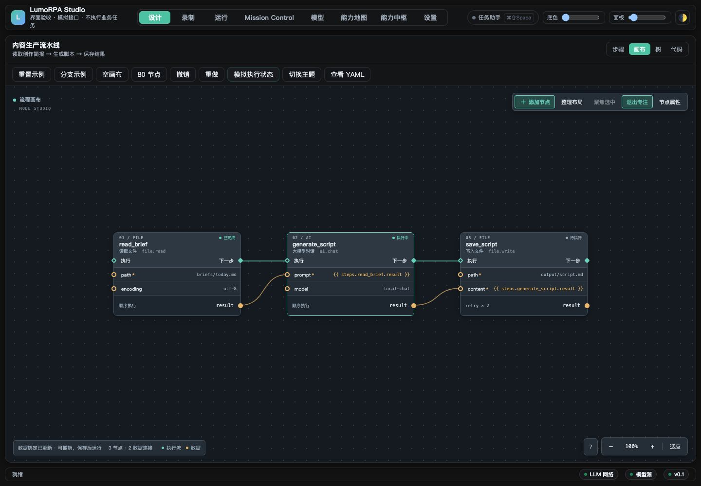
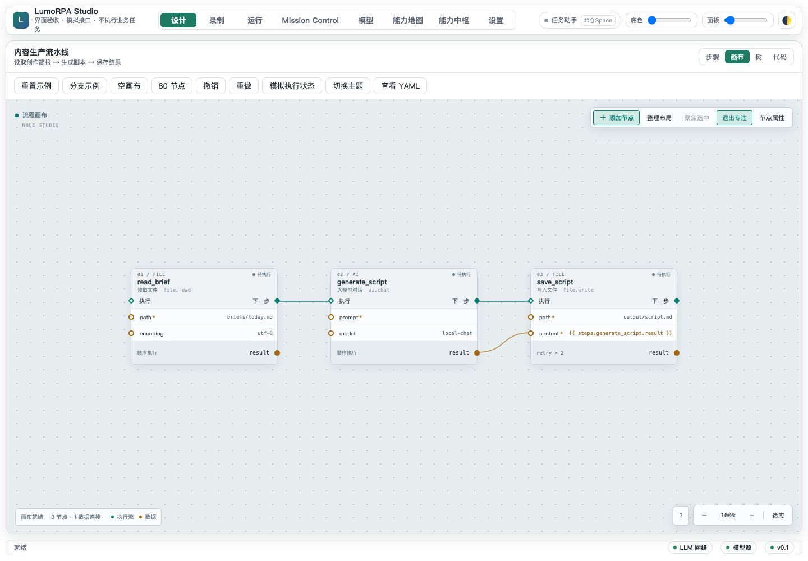
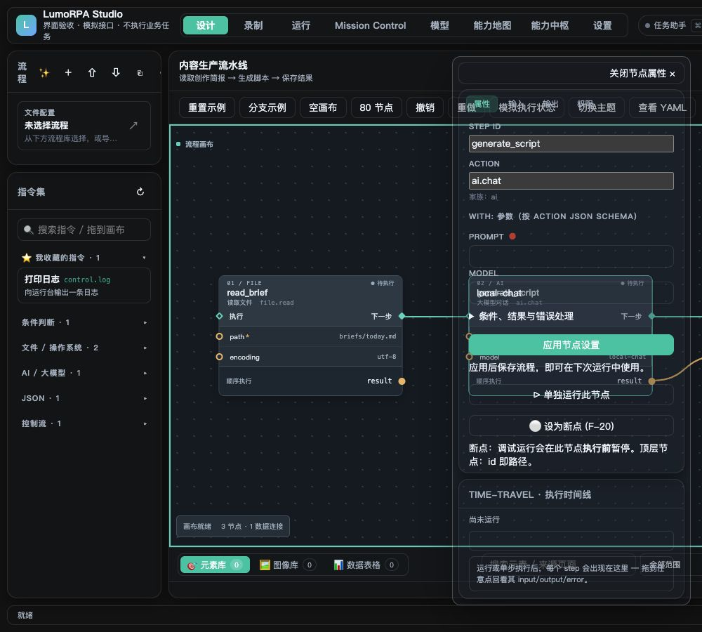

# 节点画布验收记录

日期：2026-11-10。方向：ComfyUI 风格的高密度节点与清晰端口。

页面加载产品的 HTML、CSS 和实际编辑器模块。流程列表、动作 Schema、接口与执行事件由专用 fixture 模拟；不会执行实际文件操作或 AI 任务。本记录验证前端交互，不代表 Tauri IPC、真实模型或实际任务端到端验收。

## 自动化结果

- `cd apps/desktop/frontend && npm test`：**323 通过，0 失败，0 跳过**。
- `cd apps/desktop/frontend && npm run lint`：通过。
- `git diff --check`：通过。
- [完整测试输出](frontend-tests.txt)。覆盖模型、YAML 绑定与顺序变更、稳定选中、源码/布局撤销、运行态隔离和属性草稿回归。

## 浏览器交互验收

| 场景 | 观察结果 |
| --- | --- |
| read_brief.result → generate_script.prompt | 参数变为 `{{ steps.read_brief.result }}`；数据边由 1 条变为 2 条；查看 YAML 可见真实变更；撤销后恢复 |
| 已有内容的 save_script.content 改绑 | 显示原表达式与新表达式，默认焦点位于取消；取消保留原内容 |
| 拖动 generate_script | 位置由 (356, 0) 移至 (396, 147)，连线同步跟随；撤销恢复 (356, 0) |
| 将 generate_script 排到 read_brief 前 | 明确提示结果依赖会指向尚未执行的节点，阻止重排 |
| 分支流程 done → gate | 确认后同级步骤变为 done、gate；gate 的 do/else 完整保留 |
| 空画布搜索 json 并添加 json.parse | 创建唯一节点 json_parse_1；出现 text 必填输入口与未设置状态 |
| 模拟执行状态 | read_brief 已完成、generate_script 执行中、save_script 待执行，与卡片颜色对应 |
| 1000×900 属性面板 | 抽屉边界为 left=644、right=984、top=80、bottom=862；21 个表单控件存在，面板可滚动和关闭 |
| 80 节点适应视图 | 80 个节点均落在可视范围；状态栏为 80 节点 / 0 数据连接；缩放为 4% |
| 深浅主题 | 卡片和文字清晰，执行口/数据口颜色与几何位置一致；浅色数据端口为 #a36714 |

[测量数据](metrics.json)记录测试尺寸。80 节点结果只说明全图适应正确，没有测量帧率或千级节点性能。

## 截图

深色主题，包含真实数据绑定与模拟运行状态（1440×1000）：



浅色主题（1440×1000）：



窄屏属性抽屉（1000×900）：



## 本机复现

从仓库根目录运行：

```sh
python3 -m http.server 59693 --bind 127.0.0.1 --directory apps/desktop/frontend
```

访问 `http://127.0.0.1:59693/test/graph-studio.probe.html`。测试页保存在 `test/`，fixture 模块位于 `fixtures/graph-studio.probe.js`，避免被 `node --test` 当作 Node 测试执行。页面有标准流程、分支流程、空画布、80 节点、撤销/重做、模拟执行状态和查看 YAML 入口。

使用后停止临时服务。验收结束时已恢复临时浏览器视口尺寸覆盖。

后续功能与实现边界见[画布分析与开发记录](../../../superpowers/plans/2026-11-10-canvas-studio.md)。
