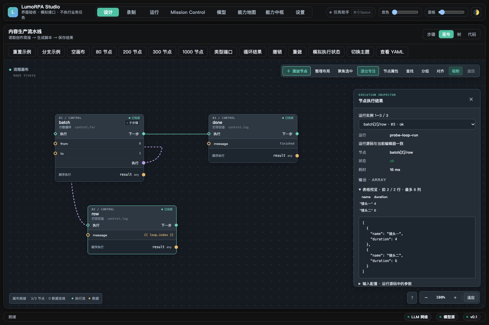
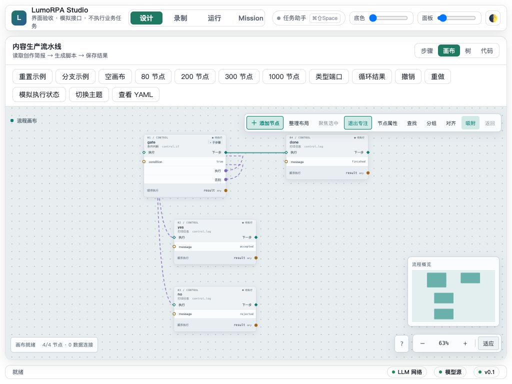

# 画布、执行结果与发布交付优化验收

日期：2026-11-20。工作分支：`dev`；开发基线：`367b91945dd47e139fba6e52f11eb07cb25f1958`。

对应 [2026-11-19 项目优化复核](../../../superpowers/plans/2026-11-19-project-optimization-audit.md)。本轮在主工作目录完成开发，未创建 worktree，未提交、推送或发布。

## 实现范围

| 原审计项 | 本轮变更 |
| --- | --- |
| A1 历史结果竞态 | 历史加载、费用分页和延迟详情绑定运行身份；过期请求不能覆盖当前选择，关闭抽屉和切换节点会使在途请求失效。 |
| A2 节点改名 | 原子迁移静态结果引用、断点、布局、分组成员和中继点；一次撤销恢复相关数据。 |
| A3 子图复制 | 整个选区统一分配 ID，迁移内部引用，保留外部依赖；支持行内 YAML、祖先/后代选区去重，按实际插入数反馈。 |
| A4 嵌套单步结果 | 保存原始节点身份和执行根路径，控制子树及循环路径可准确映射回画布；继续按流程、源码和 runId 隔离。 |
| A5 标量结果 | `false`、`0`、空字符串和 JSON `null` 均可查看，区别于没有记录。 |
| A6 长图适应 | 适应缩放允许低于 2%，包含分组边界并预留结果抽屉空间；概览分层显示，搜索后可返回原视口。 |
| B1 状态/拖动性能 | 执行状态按路径索引并增量聚合，刷新合并到动画帧，跳过未变化的 DOM 状态；拖动只更新相关节点和相邻边。 |
| B2 大结果 | 历史列表 60 条分页，步骤/循环选择器和费用明细 200 条分页；结果载荷、变量快照按需读取，JSON/表格预览限制遍历和显示规模。完整轻量摘要保留以支持全图状态和精确实例查找。 |
| B3 布局迁移 | 版本化 `.yaml.layout.json` sidecar，写入队列、原子落盘、本地待保存恢复；另存为复制布局，撤销只保存当前流程布局；校验坏缓存，隔离跨流程与延迟保存。 |
| C1 结果联动 | 节点与时间线双向定位，独立结果抽屉、运行/源码身份、循环实例切换、文本/JSON/表格/图像预览、导出与重跑入口。参数区明确表示运行源码中的配置，不冒充执行时模板渲染后的实际输入。 |
| C2 画布组织 | 命名/着色分组与控制子树折叠，保留边界连线和失败状态；节点搜索、返回、缩略图、中继点、吸附、对齐、缩放分层和深浅主题。 |
| C3 类型端口 | 动作输出契约 `output_schema` / `x-lumo-output`；字段级输出端口、类型匹配、高亮与冲突说明，未知类型保留兼容行为；静态字段/索引读取保持 JSON 类型。 |
| D1–D3 发布交付 | 同一 SHA 的完整 CI/原生门禁，跨平台产物齐备后发布；macOS 证书导入、签名/公证校验与清理；安装包固化更新地址、公钥和渠道，签名清单与摘要校验；草稿暂存、重试校验及渠道版本防回退。 |
| D4 原生覆盖 | 扩展画布编辑→执行→结果及桌宠跨窗口助手场景，主 CI 加入 `dev` PR。原生场景的本轮实际执行情况见下方边界说明。 |

## 额外修复的交互边界

- 1024px 窗口下顶部导航自动最小宽度撑出画布：顶栏、导航与内容列使用可收缩约束。
- 从代码视图点击执行记录：先构建当前流程画布，再定位准确节点。
- 搜索后属性浮层遮住“返回”：导航保持搜索/返回控件可达。
- 拖动分组成员：同步更新分组框的显示位置与适应画布的边界。
- 布局撤销后旧视口定时器覆盖新对象：保存时读取最新布局，显式保存取消旧任务。
- 中继点拖动途中切换流程：取消手势只恢复原流程的中继点，不修改新流程布局。
- 循环实例选择引起同步聚焦回调：保留用户所选实例，避免重新选中最后一次执行。
- 结果抽屉打开时隐藏重复的时间线详情，保留时间线导航；关闭抽屉后恢复详情。JSON 预览按内容高度排版，避免被压缩成单行窄缝。

## 自动化验证结果

| 验证范围 | 结果 |
| --- | --- |
| 前端 `npm test` | 389/389 通过；包含历史竞态、标量结果、1001 轮双节点实例分页、重命名/复制、布局恢复与跨流程隔离。 |
| 前端 `npm run lint` | 通过。 |
| `cargo test -p lumorpa-desktop --lib` | 138/138 通过。 |
| `cargo test -p lumo-storage` | 76/76 通过；包括步骤摘要、变量快照与费用分页。 |
| 动作与 DSL 定向验证 | actions 库 129 项、输出契约 3 项及 DSL 完整 90 项通过；core 相关测试通过。 |
| scripts Python unittest | 59/59 通过；包含真实 Minisign 签名校验，以及草稿查询、发布失败重试、产物失配、较旧构建晚完成的模拟回归。 |
| 工作流与脚本 | 5 个 workflow 的 actionlint 通过；新增两个发布 shell 脚本的 ShellCheck 通过，5 个相关脚本 `bash -n` 通过。 |
| 格式与补丁 | `cargo fmt --all --check`、`git diff --check` 通过。 |

最终前端测试之后仅调整结果面板 CSS，并通过浏览器复验确认：1440×960 下只显示一份结果详情、JSON 预览高度正常；关闭抽屉后时间线详情恢复。800px 默认视口和 1024px 窗口均未出现横向溢出，当前测试页未捕获控制台 error。

OCR 合同测试在全量并行负载下出现过夹具启动超时：测试预算从 2 秒改为 10 秒；独立的 180ms 超时与子进程清理测试保持不变并通过。旧打包脚本仍有既有 ShellCheck 告警（模式匹配/参数拆分、未使用变量、文件列表展示与 `--bundles all` 的文件计数），未将其作为本轮全部消除的检查项。

## 浏览器交互验收

测试页使用真实前端模块、样式和模拟 IPC，不执行实际业务任务。访问路径：`http://127.0.0.1:59693/verify-20261120/test/graph-studio.probe.html`。此处记录浏览器交互证据，不能替代原生 Tauri WebView 验收。

- 验证不兼容端口拒绝绑定并解释原因；字段级 text→content 连线写入正确引用，撤销后移除。
- 验证双节点分组、折叠后的真实边界连线、搜索隐藏节点并展开定位。
- 验证节点拖动、网格吸附、中继点创建/拖动/撤销。
- 验证代码视图→时间线→画布定位，循环输出 `false`、`0`、表格等实例切换。
- 验证 1024×768 的普通/专注布局没有横向溢出；1000 节点适应后边界位于画布内，搜索聚焦后可返回 0.25% 概览。
- 验证深浅主题及结果抽屉，测试结束恢复浏览器默认视口。

## 状态投影基准

命令：`node --expose-gc apps/desktop/frontend/benchmarks/graph-performance.mjs`。每个样本创建独立运行上下文；预热 1 次、测量 5 次，取中位数。测量纯 JavaScript 状态投影，不包含 DOM/SVG、IPC 或原生 WebView，因此不是浏览器 FPS 或桌面内存指标。

| 节点/状态数 | 审计基线 | 本轮中位数 |
| --- | ---: | ---: |
| 80 / 80 | 0.59 ms | 0.139 ms |
| 300 / 300 | 6.99 ms | 0.330 ms |
| 1000 / 1000 | 81.46 ms | 1.656 ms |

10000 次循环状态增量聚合总计中位数 8.001 ms。单次微基准有运行环境抖动，应按相同方法比较复杂度与数量级。

## 验收边界

- 本机验证不包含 Linux 原生录制/桌面 E2E。本轮已补充自动化场景和发布依赖门禁，实际跨平台执行仍须由 CI 给出结果。
- 未使用 Apple 发布凭据生成真实签名、公证安装包，也未执行“安装旧版→更新→重启新版本”的完整实机升级。
- 发布脚本通过本地测试与模拟 GitHub 响应验证，不等于真实发布成功；本轮未发布任何版本。
- 大载荷按需读取和显示已设限；完整轻量执行摘要仍随步骤数量线性增长。不能据此宣称十万步骤已通过原生 WebView 的内存与帧率验收。

## 完成摘要与循环实例选择基准

命令：`node --expose-gc apps/desktop/frontend/benchmarks/run-summaries.mjs`。原始结果：[run-summaries-node.json](run-summaries-node.json)。环境为 Node v22.22.2、macOS arm64，预热 1 次后测量 5 次取中位数。合成数据包含 `control.for_each` 下 3 个子节点、0.1% 失败记录、真实 `StepRunDto` camelCase 字段及时间戳；`outputJson` 和 `varsJson` 为按需读取的空载荷。表中数量表示步骤记录数，非循环轮数。

| 逻辑指标 | 10000 条摘要 | 100000 条摘要 |
| --- | ---: | ---: |
| JSON UTF-8 体积 | 3.078 MiB | 31.063 MiB |
| JSON 序列化 | 2.896 ms | 29.291 ms |
| JSON 解析 | 3.944 ms | 47.124 ms |
| 完成响应状态聚合 | 5.675 ms | 82.992 ms |
| 首次画布状态索引 | 5.690 ms | 85.916 ms |
| 原实例选择页全量扫描 | 3.261 ms | 37.167 ms |
| 首次数值行索引构建 | 3.292 ms | 36.240 ms |
| 复用索引读取当前实例页 | 0.008 ms | 0.038 ms |

实例索引只保留摘要数组中的数值行号，重复选择不再遍历所有摘要；当前实例通过二分查找定位，只转换当前页最多 200 条。所有步骤摘要与重试记录仍完整保留，完整输出及变量继续通过 `read_run_step` 获取。缓存以摘要数组、运行/流程/源码身份、AST 和单步执行根路径为边界，避免混用结果。

开启 V8 显式 GC 并跨事件循环测量保留堆后，100000 条反序列化摘要约占 33.494 MiB，完成上下文额外 12.876 MiB，画布聚合索引额外 5.238 MiB，实例数值索引额外 0.777 MiB。结果定位只保留 `runId`、`flowPath`、`source`、`selectedRuntimePath` 四字段，避免继续引用完成前的进度链：本合成数据中，10000/100000 条记录各产生两次进度事件，释放约 3.738/37.384 MiB。进度路径与摘要共享字符串，因此该项是保守的合成保留堆估计。

以上是 Node/V8 逻辑与保留堆测量，不包含 Rust 序列化、SQLite、IPC、DOM/SVG 或原生 WebView；不能视为端到端响应延迟或桌面内存峰值。完成响应仍完整携带 O(N) 轻量摘要，首次解析、状态聚合与索引构建也仍为 O(N)。若要进一步支撑十万级常态运行，应追加后端按节点聚合状态与实例游标查询接口，并通过真实 WebView 量测再决定迁移策略。

